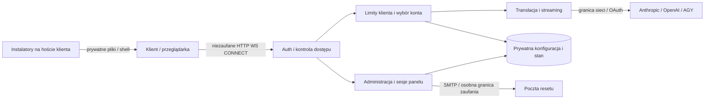

# Rozpoznanie AgentLB

Baza `509ddf1`, gałąź `ai/systematic-audit-2026-10-22`. 196 śledzonych plików, 43 588 linii `src/*.js` na początku. Pełny spis z hashami: `01-reconocimiento.json`.

Stanowy lokalny proxy dla kont Claude/Codex/AGY, panel i instalatory klientów.

## Model zagrożeń STRIDE

| Komponent | Zagrożenie | Kontrola i dowód |
|---|---|---|
| HTTP/WS auth | Spoofing/Elevation | regresje auth/deep-audit/relay |
| Relay upstream | Information disclosure | BUG-001 i BUG-011; usuwanie lokalnych poświadczeń |
| Quota/fallback | Tampering/Denial of service | BUG-002/003; kontrola drugiego żądania 429 |
| Instalatory | Tampering/Elevation | BUG-006/008/009; literalne dane, 0600, odmowa błędnego JSON |
| Obraz/CI | Supply-chain/Elevation | BUG-005/010; npm audit/Trivy/quality gates |
| Konfiguracja/stany | Tampering/Repudiation | istniejący atomic rename/lock; testy, bez modyfikacji danych produkcyjnych |

Brak zadeklarowanego SLO, okien serwisowych i potwierdzonego reżimu regulacyjnego. Ryzyka prywatności obejmują prompty, identyfikatory sesji, zużycie i logi; audyt nie potwierdza retencji/RODO na wdrożeniu.
